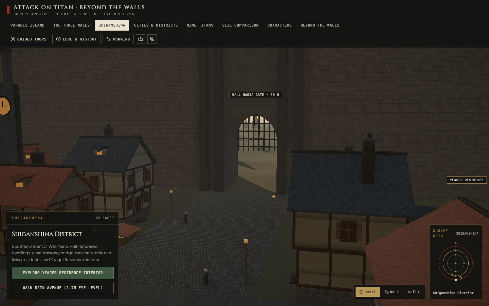

# Attack on Titan — Beyond the Walls

A real-time interactive 3D exploration archive of Paradis Island, the three 50-meter concentric Walls (Maria, Rose, and Sina), Shiganshina District, the Nine Titans, and Survey Corps characters, built at consistent `1 unit = 1 meter` metric scale using Three.js, React Three Fiber, Drei, GSAP, custom GLSL shaders, and Next.js.

- **Live 3D Experience:** https://bapdagreat.github.io/attack-on-titan-beyond-the-walls/
- **Source Repository:** https://github.com/BapDaGreat/attack-on-titan-beyond-the-walls



## Real-Time 3D Realms

- **Paradis Island Strategic Relief (`1:1000 km` macro overview):** Domain-warped terrain heightfield with slope/moisture vertex coloration, Gerstner deep-water coastal ocean shader with analytic derivatives and horizon fog matching, concentric Walls Maria (`480 km`), Rose (`380 km`), and Sina (`250 km`), and clickable district markers.
- **The Three Walls (`1:1 m`):** Full `50.0 m` vertical ashlar masonry wings, arched `wall-gatehouse.glb`, rail-mounted `wall-cannon.glb` batteries, `1.70 m` human scale reference, toggleable `60 m` Colossal Titan peering over Wall Maria, **Survey Scan X-Ray Cutaway** shader revealing rows of dormant Wall Titans inside the stone core, and Wall Maria → Rose → Sina camera flight.
- **Shiganshina District & Yeager Residence Interior (`1:1 m`):** Half-timbered medieval dwellings (`house-timber-a/b`, `house-townhouse`), `bell-tower.glb`, cobblestone avenues, stone river canal with masonry arch bridge, moving horse-drawn supply wagon, animated citizens/soldiers, and walkable **Yeager Residence (`yeager-house.glb`)** with hearth firelight and Grisha's cellar trapdoor.
- **Cities & Districts:** Interactive switcher covering Shiganshina, Trost (boulder-sealed gate), Stohess (cathedral spire plaza), Mitras (royal citadel), Orvud, Karanes, Utopia, Ehrmich, and Survey Corps HQ, distinguishing canon locations from architectural reconstructions.
- **Nine Titans & Pure/Abnormal Showcase:** Sculpted anatomical models for all Nine Titans (Founding, Attack, Colossal, Armored, Female, Beast, Jaw, Cart, War Hammer) plus 7 m Pure and 12 m Abnormal Titans, optional human inheritor comparison, and a golden lightning + shockwave transformation sequence.
- **Scale Comparison Laboratory (`1:1 m`):** Side-by-side comparison of humans, horses, houses, Pure Titans, the Nine Titans, the `50 m` Walls, and Eren's Doomsday Founding Titan against laser-accurate metric height lines, `1.70 m` human eye-level camera, silhouette mode, and X-ray overlays.
- **Character Showcase (`1:1 m`):** Full-body turntable inspection of 11 major characters (Eren, Mikasa, Armin, Levi, Erwin, Hange, Reiner, Bertholdt, Annie, Zeke, Historia) equipped with woven cloth cloaks and `odm-gear.glb`.
- **Beyond the Walls:** `80 m` Forest of Giant Trees, volumetric crepuscular sun shafts, tumbling alpha-tested foliage, Pure/Abnormal Titans, and Utgard Watchtower ruins.
- **Guided Tours, Atmosphere & Controls:** Six multi-stop guided tours, smooth Morning / Midday / Sunset / Night sky interpolation, Clear / Overcast / Rain / Storm weather modifiers, Orbit / Walk (`WASD` + AABB collision) / Fly modes, touch joystick, Photography Mode (`H`), and PNG capture.

## Architecture & Asset Pipeline

- **Real Binary `.glb` Generator (`scripts/generate-glbs.mjs`):** Builds 9 beveled architectural and equipment models into `public/models/` using Three.js `GLTFExporter` with world-meter UVs (`writeWorldUVs`) and merged material groups (`stone`, `timber`, `plaster`, `roofClay`, `roofSlate`, `metal`, `brass`, `glass`, `cloth`).
- **Procedural High-Resolution PBR Textures (`src/engine/textures.ts`):** Synthesizes aligned albedo (`SRGBColorSpace`), normal, and roughness (`NoColorSpace`) textures for masonry, cobblestones, oak/hinoki timber, scalloped roof tiles, lime plaster, striated muscle, hardened osteoderm armor, woven cloth, brushed metal, and soft radial steam sprites.
- **Custom GLSL Shaders (`src/engine/shaders.ts`):** 6-stop atmospheric sky dome, Gerstner ocean water with footprint moiré suppression, world-space Wall Survey X-ray cutaway (`USE_INSTANCING`-aware), and edge-faded crepuscular god rays.
- **World Bible & Provenance (`docs/WORLD_BIBLE.md`):** Documents unit conventions, color tokens, lighting ratios, performance tiers (`Ultra`, `High`, `Medium`, `Low`), and honest scope notes. All geometry and textures are procedurally generated locally with zero external model CDN dependencies.

## Local Development

```bash
npm install
npm run dev
```

Generate binary `.glb` assets and run a static production build (`out/`):

```bash
npm run build
```

Typecheck:

```bash
npm run typecheck
```

## Project Structure

```text
├── docs/WORLD_BIBLE.md
├── public/models/             # Generated binary GLB models
├── scripts/generate-glbs.mjs  # Build-time Three.js GLTFExporter pipeline
└── src/
    ├── app/                   # Next.js App Router entry, layout, icon, styles
    ├── components/
    │   ├── scene/             # R3F 3D worlds, GLB loader, Titans, Characters, CameraRig, PostEffects
    │   └── ui/                # Museum HUD, native <dialog> modals, Survey minimap, TouchJoystick
    ├── data/                  # Lore, districts, Titans, characters, scale subjects, guided tours
    └── engine/                # Noise, procedural PBR textures, geometry builders, GLSL shaders, collision
```

## Attribution & Non-Affiliation

Fan-created architectural and educational 3D exploration tribute inspired by Hajime Isayama's *Attack on Titan*. Not affiliated with or endorsed by Kodansha, MAPPA, or Wit Studio. Development practices and 3D shader/material workflows follow [@MengTo/Skills](https://github.com/MengTo/Skills). Runtime loads Google Fonts (`Cinzel`, `Plus Jakarta Sans`, `JetBrains Mono`) when online and falls back cleanly to system serif/sans/monospace fonts offline.
